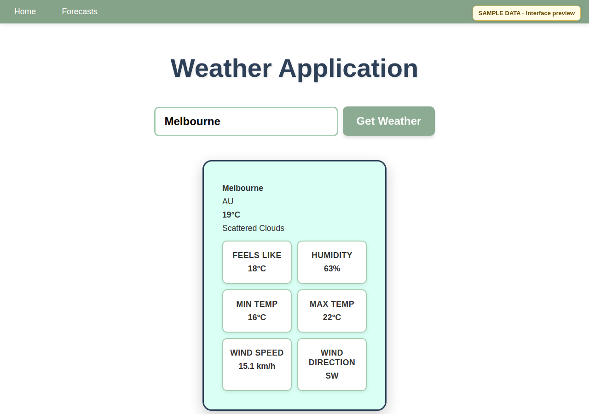
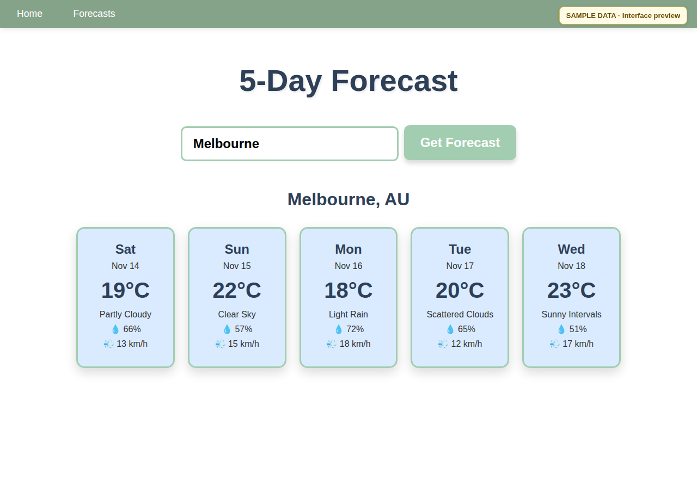
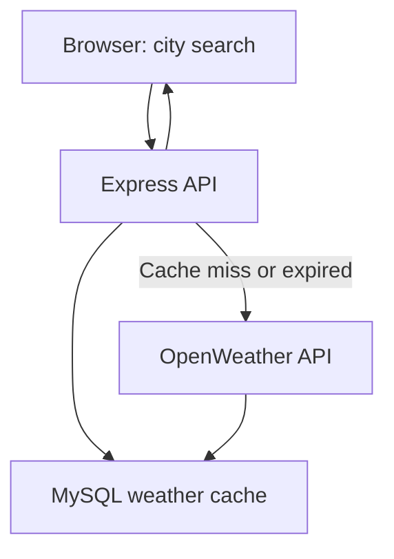

# Weather App

A small full-stack weather dashboard built with JavaScript, Node.js, Express, and MySQL. Search for a city to view current conditions, a five-day forecast, and any weather alerts returned by the OpenWeather API.

During development, this project also used **Azure App Service** with a **GitHub Actions test-to-production pipeline**. Those cloud resources have since been decommissioned. The deployment configuration is preserved as a historical example, while the active workflow runs CI checks only.

## Interface previews

These images show the real WeatherApp frontend rendering **illustrative sample API responses** for Melbourne. They are not live weather observations or evidence of a functioning Azure deployment; the original backend resources have been retired.

**Current conditions**



**Five-day forecast**



## Features

- **Current weather:** temperature, description, humidity, wind speed/direction, and minimum/maximum temperatures.
- **Five-day forecast:** a daily summary derived from OpenWeather's forecast response.
- **Weather alerts:** displays alerts when the API returns them; otherwise shows an empty or error state.
- **Database-backed caching:** city weather responses are cached in MySQL for 20 minutes to reduce repeat external API requests.
- **Search logging:** requested cities and request IPs are written to a MySQL table. Consider this if deploying the app or handling user data.
- **Continuous integration:** GitHub Actions installs dependencies, runs the build command, and executes the test suite without requiring cloud credentials.
- **Historical deployment design:** the previous Azure test → health check → production workflow remains available for inspection, but is no longer active.

## Stack

| Layer | Technology |
| --- | --- |
| Frontend | HTML, CSS, browser JavaScript |
| Backend | Node.js, Express |
| External API | OpenWeather |
| Storage | MySQL (`mysql2`) |
| Current CI | GitHub Actions (build and tests) |
| Historical deployment | Azure App Service with OIDC authentication |

## How it works



The Express server exposes:

| Endpoint | Purpose |
| --- | --- |
| `GET /weather?city=Melbourne` | Current weather; uses a 20-minute MySQL cache |
| `GET /forecast?city=Melbourne` | Five-day forecast |
| `GET /alerts?lat=-37.81&lon=144.96` | Weather alerts for coordinates |

The frontend is served from the same Express app. The server creates `weather_cache` and `searches` tables if they do not already exist.

## Run locally

**Requirements:** Node.js 22+ (as specified by `package.json`), npm, a reachable MySQL database, and an [OpenWeather API key](https://openweathermap.org/api).

1. Clone the repository and install dependencies:

   ```bash
   git clone https://github.com/R1T-DEYE/WeatherApp.git
   cd WeatherApp
   npm ci
   ```

2. Create a local `.env` file in the repository root (do **not** commit it):

   ```dotenv
   WEATHER_API_KEY=your_openweather_api_key
   DB_HOST=your_database_host
   DB_PORT=3306
   DB_USER=your_database_user
   DB_PASS=your_database_password
   DB_NAME=your_database_name
   PORT=3000
   ```

3. Start the app:

   ```bash
   npm start
   ```

4. Open <http://localhost:3000/> for current weather, or <http://localhost:3000/forecast.html> for the forecast.

> **Database note:** The current MySQL connection requests TLS (`minVersion: TLSv1.2`). Your database must accept this configuration. The app needs database access even before its HTTP server starts, because it initializes the tables at startup.

## Continuous integration and historical deployment

**Current status (November 2026):** The Azure test and production resources used for coursework are no longer available. There is **no live Azure deployment or hosted demo** for this project.

The active [CI workflow](.github/workflows/ci.yml) runs on pull requests and pushes to `main`, and can also be triggered manually. It:

1. Sets up Node.js 22 (matching the version requirement in `package.json`).
2. Installs the application and test dependencies using their lockfiles.
3. Runs the configured build command and the test suite.

The included tests currently cover a few data-formatting examples; they are **not** comprehensive API or end-to-end tests. CI does not connect to Azure or attempt to deploy the app.

### Archived Azure pipeline

The original [Azure deployment workflow](docs/archived-workflows/azure-deploy.yml) is kept outside `.github/workflows/`, so GitHub Actions **will not execute it**. The preserved workflow documents the earlier design:

1. Build and test the Node.js application.
2. Package the application as an artifact.
3. Authenticate with Azure using OIDC and deploy to a test app.
4. Perform an HTTP health check before progressing.
5. Deploy the same artifact to production.

The archived YAML references retired Azure resources and the old Node.js 20 configuration. It is historical source material, **not a ready-to-run deployment**. Restoring deployment would require provisioning new Azure infrastructure, updating authentication, and revalidating the pipeline.

## Project notes

- The app depends on OpenWeather availability and on your API plan's access to the weather-alerts endpoint.
- The cache applies to current-weather lookups, not the forecast or alerts endpoints.
- API keys and database credentials belong in environment variables, not Git.
- This is a learning/portfolio project; it is not presented as a production weather-warning service.
