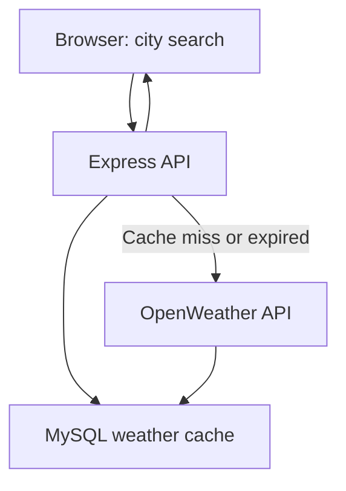

# Weather App

A small full-stack weather dashboard built with JavaScript, Node.js, Express, and MySQL. Search for a city to view current conditions, a five-day forecast, and any weather alerts returned by the OpenWeather API.

This project also explores deploying a Node.js application to **Azure App Service** through a **GitHub Actions test-to-production pipeline**.

## Features

- **Current weather:** temperature, description, humidity, wind speed/direction, and minimum/maximum temperatures.
- **Five-day forecast:** a daily summary derived from OpenWeather's forecast response.
- **Weather alerts:** displays alerts when the API returns them; otherwise shows an empty or error state.
- **Database-backed caching:** city weather responses are cached in MySQL for 20 minutes to reduce repeat external API requests.
- **Search logging:** requested cities and request IPs are written to a MySQL table. Consider this if deploying the app or handling user data.
- **CI/CD:** GitHub Actions builds and tests the project, deploys to an Azure test app, checks its health, and then deploys to a production app.

## Stack

| Layer | Technology |
| --- | --- |
| Frontend | HTML, CSS, browser JavaScript |
| Backend | Node.js, Express |
| External API | OpenWeather |
| Storage | MySQL (`mysql2`) |
| Deployment | Azure App Service, GitHub Actions, Azure OIDC login |

## How it works



The Express server exposes:

| Endpoint | Purpose |
| --- | --- |
| `GET /weather?city=Melbourne` | Current weather; uses a 20-minute MySQL cache |
| `GET /forecast?city=Melbourne` | Five-day forecast |
| `GET /alerts?lat=-37.81&lon=144.96` | Weather alerts for coordinates |

The frontend is served from the same Express app. The server creates `weather_cache` and `searches` tables if they do not already exist.

## Run locally

**Requirements:** Node.js 22+ (as specified by `package.json`), npm, a reachable MySQL database, and an [OpenWeather API key](https://openweathermap.org/api).

1. Clone the repository and install dependencies:

   ```bash
   git clone https://github.com/R1T-DEYE/WeatherApp.git
   cd WeatherApp
   npm ci
   ```

2. Create a local `.env` file in the repository root (do **not** commit it):

   ```dotenv
   WEATHER_API_KEY=your_openweather_api_key
   DB_HOST=your_database_host
   DB_PORT=3306
   DB_USER=your_database_user
   DB_PASS=your_database_password
   DB_NAME=your_database_name
   PORT=3000
   ```

3. Start the app:

   ```bash
   npm start
   ```

4. Open <http://localhost:3000/> for current weather, or <http://localhost:3000/forecast.html> for the forecast.

> **Database note:** The current MySQL connection requests TLS (`minVersion: TLSv1.2`). Your database must accept this configuration. The app needs database access even before its HTTP server starts, because it initializes the tables at startup.

## Deployment pipeline

The workflow in [`.github/workflows/deploy-single-branch.yml`](.github/workflows/deploy-single-branch.yml) is triggered by pushes to `main` or manually:

1. Install dependencies and run the configured build/test commands.
2. Package application files as a GitHub Actions artifact.
3. Authenticate to Azure with OIDC and deploy to `weatherapp-test`.
4. Poll the test site's root URL until it responds successfully.
5. Deploy the same artifact to `weatherapp-prod`.

Deployment requires the Azure app services, federated identity setup, and repository secrets referenced by the workflow. The included tests currently cover a few basic data-formatting examples; they are **not** comprehensive API or end-to-end tests. The workflow uses Node.js 20 while the root `package.json` specifies Node.js 22+, so these versions should be aligned before relying on the pipeline for a fresh deployment.

## Project notes

- The app depends on OpenWeather availability and on your API plan's access to the weather-alerts endpoint.
- The cache applies to current-weather lookups, not the forecast or alerts endpoints.
- API keys and database credentials belong in environment variables, not Git.
- This is a learning/portfolio project; it is not presented as a production weather-warning service.
